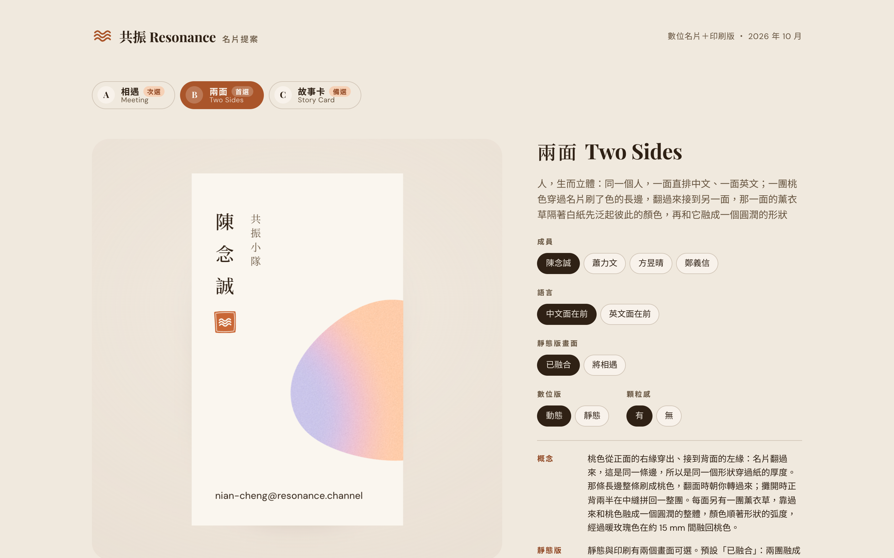
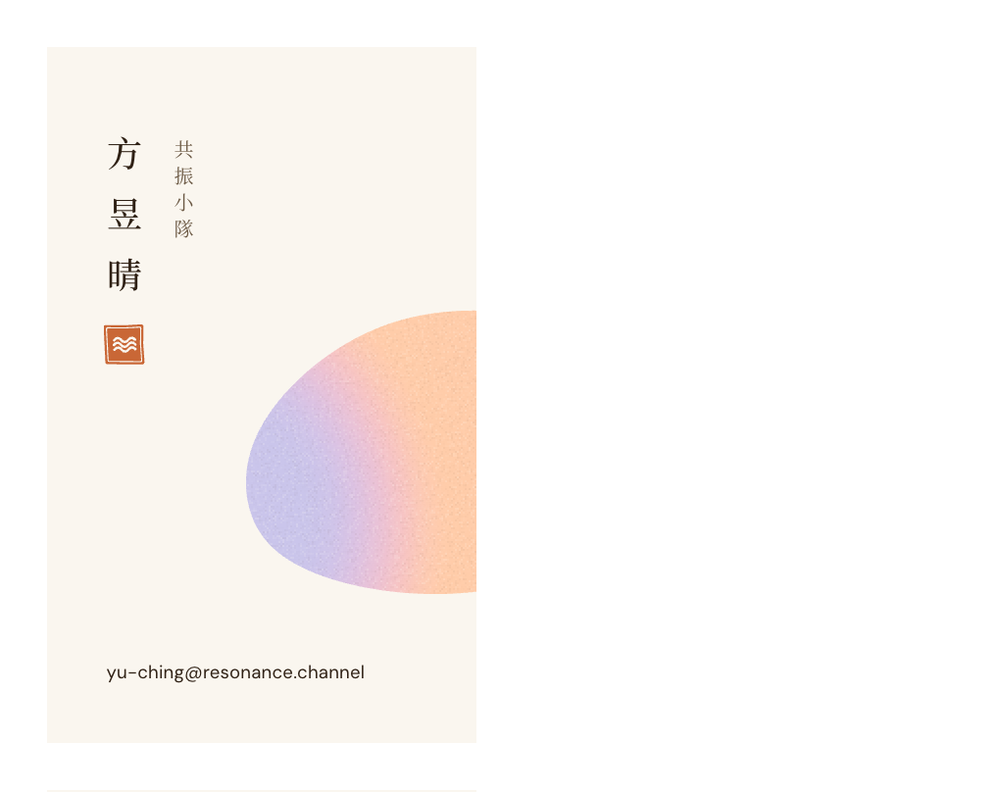

# 共振 Resonance 名片

共振團隊的名片：一張可以翻面的數位名片，以及用同一套設計輸出的印刷檔。



## 線上看

- 每個人的數位名片：[hi.resonance.channel/ncc](https://hi.resonance.channel/ncc)（陳念誠）、[/liball](https://hi.resonance.channel/liball)（蕭力文）、[/nunu](https://hi.resonance.channel/nunu)（方昱晴）、[/ted](https://hi.resonance.channel/ted)（鄭義信）、[/winnie](https://hi.resonance.channel/winnie)（薛惠馨）
- 提案頁：<https://hi.resonance.channel/>

印刷版上的 QR 碼連到的就是各自的數位名片。網域 `hi.resonance.channel` 是 Cloudflare 上的一筆 CNAME（指向 `resonance-crew.github.io`，僅 DNS），網站本身由 GitHub Pages 提供，官網不受影響。

## 頁面

| 頁面 | 內容 |
| --- | --- |
| `index.html` | 提案頁。三個設計方向可以切換，也可以換成員、語言、動態或靜態、有無顆粒感。下方是兩面的印刷稿，標出出血和裁切線 |
| `ncc.html` `liball.html` `nunu.html` `ted.html` `winnie.html` | 收到名片的人看到的頁面（網址 `/ncc` 等）：一張卡片，點一下翻面，下面可以存到聯絡人、複製 Email、認識共振。頁面語言跟著對方的瀏覽器，中文訪客先看到中文面。這幾頁由 `card.html` 產生：改了 `card.html` 或成員資料後執行 `node tools/short-pages.mjs` |

收到名片的頁面上，卡面的字、落款印和 QR 碼是預先畫好的透明圖片（`assets/type/`，每面約 15–30 KB），疊在會動的泡泡上。LINE、Facebook 的內建瀏覽器會照手機的字型大小放大網頁文字，直接排字的話名字會壓到印章、Email 超出卡片；換成圖片後，卡面在任何瀏覽器都和設計一樣，也不用等卡面的字型載入。圖片載入失敗時，卡面會改回直接排字。

卡片的動作：滑鼠移上去會傾斜、反光；點一下、左右拖曳或按 <kbd>Enter</kbd> 翻面。卡片有厚度，翻面時看得到紙邊。

## 三個方向

- **B 兩面（首選）**：直式 54 × 90 mm。一面中文、一面英文，中文名字直排，配一枚赤陶色落款印。一團桃色從正面右緣穿出，翻過來從背面左緣接上，那條共用的長邊刷成桃色。每翻到一面，那一面的薰衣草色會從 7 mm 外靠過來，和桃色融成一個圓潤的整體。靜態版有兩個畫面：「已融合」（預設，一個圓潤的形狀，接合處沒有凹口）和「將相遇」（兩團還沒碰到，面對面的邊緣先泛起對方的顏色）
- **A 相遇（次選）**：橫式 90 × 54 mm，中英並列。正面是兩團剛碰到的泡泡，每個人的配色不同；翻到背面時它們融成一團，退到角落，把版面讓給名字
- **C 故事卡（備選）**：名片本身就是一張共振的故事卡，背面是「回應一個故事的，是另一個故事」，加上 QR 碼

每個方向的概念、字級、印刷建議，都寫在提案頁卡片旁邊的說明裡。

## 印刷檔



`print/<方向>/<成員>.pdf` 每份兩頁，第一頁正面、第二頁背面。B 兩面的 `print/facets/` 是「已融合」，`print/facets-apart/` 是「將相遇」：

- 成品 90 × 54 mm，四邊各出血 2 mm，所以 PDF 頁面是 94 × 58 mm（B 兩面是直式：成品 54 × 90 mm，頁面 58 × 94 mm）
- 泡泡是向量，字型已內嵌，檔案裡只有油墨，紙色由紙張決定
- 同名的 `-front.png`、`-back.png` 是 300 dpi 的預覽圖
- 每張的 QR 碼都檢查過能掃（`tools/qr-check.html`）

重新輸出：

```bash
node tools/export.mjs facets meet story
node tools/export.mjs facets --pose=apart
```

付印之前：

- `js/people.js` 裡的 Email 是示意格式，請換成每個人真正的信箱
- 淡色（尤其薰衣草色）轉成 CMYK 容易偏灰，請先打樣

## 在本機打開

這是不用建置的靜態網站（ES modules），需要用伺服器打開，直接開檔案不會動：

```bash
python3 -m http.server 4317 --bind 127.0.0.1
```

然後打開 <http://127.0.0.1:4317>。

## 修改

| 想改的東西 | 在哪裡 |
| --- | --- |
| 成員、Email、品牌文案、色票 | `js/people.js`（新增成員後執行 `short-pages.mjs`、`type-images.mjs`、`export.mjs`，工具都從這裡讀名單；A 相遇的 `WHO`、C 故事卡的 `PAIRS` 可以指定他的配色） |
| 數位名片預設用哪個方向 | `js/share.js` 的 `DIRECTION` |
| QR 碼連到哪裡、個人短網址 | `js/people.js` 的 `CARD_BASE` 和每個人的 `short` |
| 某個方向的版面 | `directions/<方向>.js`、`directions/<方向>.css` |
| 數位名片卡面的圖片 | 改了 B 兩面的版面、成員資料或網址之後，執行 `node tools/type-images.mjs` 重新產生 `assets/type/` |

每個方向都用印刷的實際單位排版：`--mm` 是成品上的一公釐，`--pt` 是一點。所以螢幕和印刷是同一份設計，螢幕只是放大縮小。

## 結構

```
index.html, card.html     提案頁、數位名片頁
css/base.css              頁面、3D 卡片、卡面座標系
js/card3d.js              3D 卡片：傾斜、反光、翻面、紙邊（Motion 彈簧動畫）
js/blobs.js               泡泡融合引擎（移植自 Resonance 官網首頁），螢幕用 canvas，印刷輸出向量
js/ctx.js, js/app.js      方向模組的介面、提案頁
js/share.js               數位名片頁（css/organic.css、js/organic.js：從官網移植的手繪按鈕、分隔線、連結底線、語言切換）
js/people.js, js/qr.js    成員與品牌資料、QR 碼
directions/               三個設計方向
tools/                    截圖、印刷檔輸出、QR 檢查（headless Chrome）、個人頁產生器（short-pages.mjs）、卡面圖片（type-images.mjs）
assets/type/              數位名片卡面的字（透明 WebP，由 type-images.mjs 產生）
docs/BRIEF.md             設計簡報：品牌、單位、字級與印刷規則
print/                    印刷檔
```

## 致謝

- 泡泡引擎移植自 [Resonance](https://github.com/resonance-crew/Resonance) 的 `src/lib/design/driftingBlobs.ts`
- [Motion](https://motion.dev)（MIT）、[qrcode-generator](https://github.com/kazuhikoarase/qrcode-generator)（MIT），從 jsDelivr 載入
- 字型 Playfair Display、DM Sans、Noto Serif TC、Noto Sans TC（SIL Open Font License），從 Google Fonts 載入
